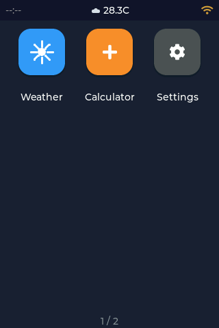
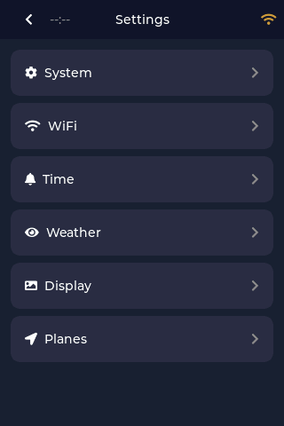
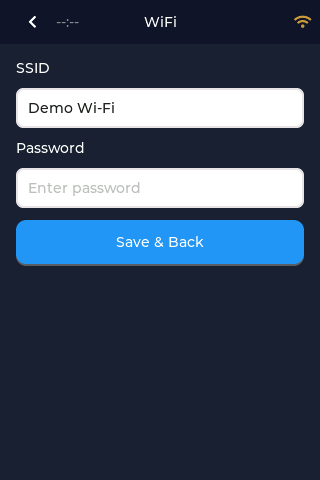
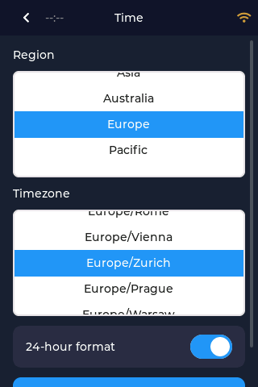
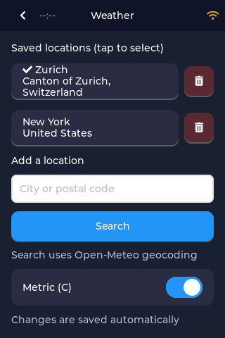
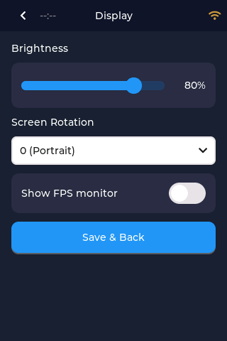
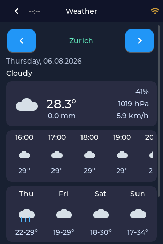
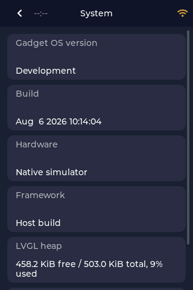

# Gadget OS User Guide

This guide covers the initial setup and everyday use of Gadget OS on the ThingPulse Color Kit Grande and Color Kit Pro. Screenshots come from the native simulator, but the controls and layout match the device.

## Getting around

Tap an app icon to open it. Use the arrow at the upper left to return to the previous screen. Lists that extend beyond the display can be moved by dragging vertically.



The status bar shows the current time, weather summary when available, and Wi-Fi status. While Gadget OS is trying to connect, the amber Wi-Fi symbol pulses. It becomes steady white when connected and steady gray when disconnected.

The home screen has multiple pages. Swipe horizontally to reveal experimental apps such as Planes. Experimental apps can use more memory or depend on external services and may be less reliable than the primary apps.

## Initial setup

Open **Settings** from the home screen. The setup areas are collected on one page:



### 1. Connect to Wi-Fi

Open **Settings → Wi-Fi**.



1. Tap **SSID** and enter the Wi-Fi network name.
2. Tap **Password** and enter its password.
3. Tap **Save & Back**.

The on-screen keyboard shows a larger popover for the selected key. Holding a key does not repeat it automatically, which makes typing on the touch display more predictable.

Connection may take several seconds. If the network is temporarily unavailable, Gadget OS keeps retrying with increasing delays rather than giving up permanently.

### 2. Set the time zone

Open **Settings → Time**.



1. Select the geographic region.
2. Select the matching time zone.
3. Choose whether to use the 24-hour clock.
4. Save the settings and return.

The clock is synchronized over the internet after Wi-Fi connects. Failed synchronization attempts are retried automatically.

### 3. Add weather locations

Open **Settings → Weather**.



To add a location:

1. Tap the search field under **Add a location**.
2. Enter a city or postal code.
3. Tap **Search** and wait for the progress indicator.
4. Select the correct result.

The selected result is added immediately. Weather locations and the active selection are saved automatically, so this screen does not require a separate Save button.

Tap a saved location to make it active. The check mark identifies the active location. Use the trash button to remove a location. The metric switch controls Celsius and metric measurements for weather data.

### 4. Adjust the display

Open **Settings → Display**.



Use this page to adjust brightness and screen rotation. **Show FPS monitor** enables LVGL's performance overlay and related serial performance logging; it is primarily intended for diagnostics.

Tap **Save & Back** after changing display settings.

## Using Weather

Open **Weather** from the home screen.



The screen contains:

- Current conditions, temperature, precipitation, humidity, pressure, and wind
- Hourly forecast
- Multi-day forecast
- Wind information further down the page

Use the large left and right buttons beside the location name to switch between saved locations. The selected location also supplies the weather summary on the home screen.

To refresh, drag the weather page downward from the top and release it. A thin progress indicator appears under the header while data is loading. Network work runs in the background, so the interface should remain responsive.

If a refresh fails, Gadget OS retains the last successfully downloaded forecast instead of replacing it with an empty screen.

## Calculator

Open **Calculator** from the home screen. Tap the numeric and operation keys as on a conventional calculator, and use the back arrow to return home.

## Planes — experimental

Swipe to the experimental home-screen page and open **Planes**. Its center point, search range, unit system, and ground-aircraft filter are configured under **Settings → Planes**.

The app can display nearby aircraft in a list or on a map. Tap a list card for aircraft, route, registration, altitude, speed, track, and distance details when those fields are available from the external data providers.

Because route enrichment and map imagery require additional network requests, this app is more sensitive to connectivity and available memory than Weather.

## System information

Open **Settings → System** to inspect the software build and current memory usage.



The memory and uptime values refresh once per second while the page is visible. The device build also reports internal heap health, PSRAM, firmware size, and flash capacity. This information is useful when diagnosing TLS failures or low-memory behavior.

## Troubleshooting

### Wi-Fi never connects

- Reopen **Settings → Wi-Fi** and verify the SSID and password.
- Move the device closer to the access point.
- Watch whether the Wi-Fi icon changes from pulsing amber to steady white.
- Gadget OS retries automatically, so a router that returns online later should reconnect without a reboot.

### The clock shows `--:--`

The clock remains unset until Wi-Fi is connected and an NTP server can be reached. Check the Wi-Fi icon and allow another synchronization retry.

### Weather does not update

- Confirm that a location is selected under **Settings → Weather**.
- Confirm Wi-Fi is connected.
- Pull down on the Weather page to retry.
- Previously downloaded information remains visible during temporary failures.

### An app becomes slow or fails to connect

Open **Settings → System** and inspect the free internal heap and largest free allocation. TLS connections need a sufficiently large contiguous internal-memory block even if the device has free PSRAM.

For developer-oriented build, serial-monitor, and release instructions, see the main [README](README.md).

## Updating this guide's screenshots

The screenshots are generated from real native-app screens using sanitized fixture data. They do not contain local Wi-Fi credentials or depend on mouse-coordinate automation.

Install the native prerequisites described in the [README](README.md), then run from the repository root:

```bash
./scripts/update-user-guide-screenshots.sh
```

The script:

1. Builds the `native` PlatformIO environment.
2. Opens each documented route with data from `documents/user-guide-fixture`.
3. Captures the exact 320×480 framebuffer as a temporary PPM file.
4. Converts it to PNG using the included Node.js converter.
5. Replaces the images under `documents/user-guide/screenshots`.

Requirements for screenshot generation are PlatformIO, SDL2, Node.js, and a graphical session in which the SDL simulator can start. Update the route list in `scripts/update-user-guide-screenshots.sh` when adding another documented screen.
