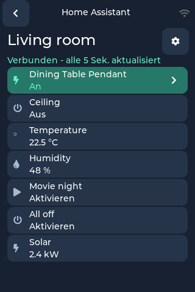
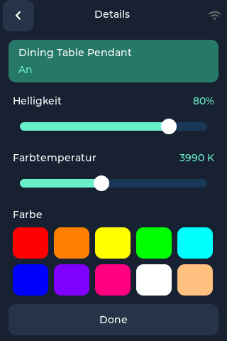
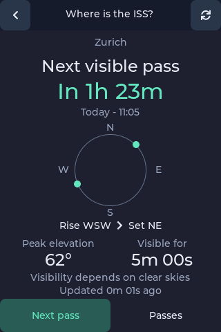
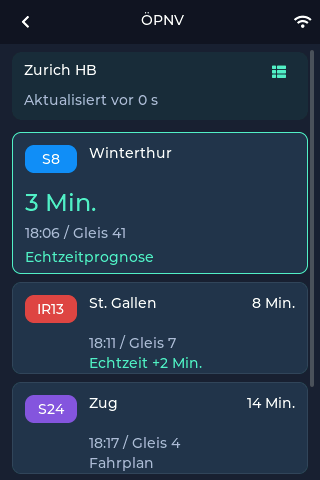
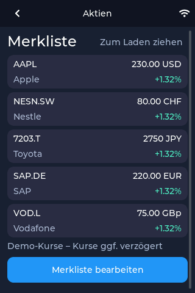
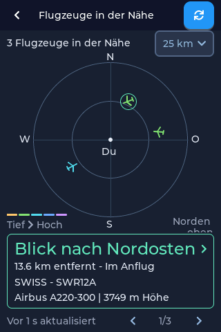
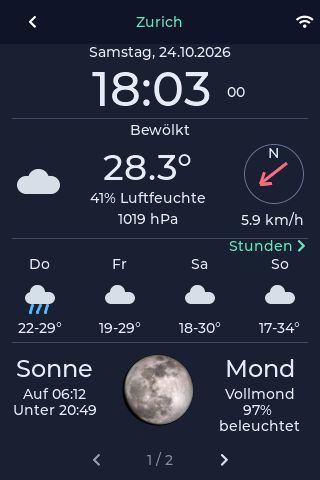

# Gadget OS Neuerungen seit v0.1.3

Neue Apps und Verbesserungen für das **Color Kit Grande**: das Zuhause steuern,
die ISS beobachten, Abfahrten prüfen und Aktien verfolgen – direkt vom Startbildschirm.

[English](since-v0.1.3.en.md)

## Home Assistant

**Home Assistant** ist jetzt auf dem Hauptbildschirm verfügbar. Verbinde deine
eigene Home-Assistant-Installation und ordne Lampen, Schalter, Sensoren, Szenen und
Skripte auf bis zu vier eigenen Seiten an. Öffne **Konfigurieren** und scanne den
QR-Code, um Geräte bequem im Browser auszuwählen und anzuordnen.

Kompakte Zeilen zeigen mehr vom Gerätenamen und bieten Platz für sieben Einträge
pro Seite. Bei nur einer Seite entfallen die Bedienelemente zum Blättern. Über den
Pfeil einer Lampe lassen sich Helligkeit, Farbtemperatur und – falls unterstützt –
die Farbe ändern. Gerätename und Ein-/Aus-Zustand stehen gemeinsam auf der Taste,
sodass mehr Platz für die Regler bleibt.

Die Gerätesuche startet mit Lampen, lädt erst nach einer Suche und zeigt jeweils
25 Treffer. Nicht verfügbare Geräte sind standardmässig ausgeblendet; der Filter
lässt sich abschalten. Geräte können auch direkt über ihre Entity-ID hinzugefügt
werden. Ausstehende Aktionen werden angezeigt, bis Home Assistant sie bestätigt.

## ISS

Die neue **ISS**-App zeigt, wann du nach der Internationalen Raumstation Ausschau
halten kannst. Sie verwendet den aktiven Wetterstandort oder ersatzweise den
Standort der Flugzeug-App.

Du siehst den Countdown, Auf- und Untergangsrichtung, die maximale Höhe über dem
Horizont und die voraussichtliche Sichtbarkeitsdauer. Während des Überflugs werden
Fortschritt und verbleibende sichtbare Zeit angezeigt. Die Überflugliste lässt
sich zwischen sichtbaren und allen Überflügen umschalten. Vorhersagen bleiben
gespeichert; ältere Daten und Offline-Zustände sind gekennzeichnet. Freie Sicht
und ein klarer Himmel sind weiterhin nötig. Die Abbildung zeigt die englische Ansicht.

## ÖPNV

Die neue **ÖPNV**-App bringt die Abfahrtstafel auf den Hauptbildschirm. Suche nach
Haltestellen, speichere bis zu acht Favoriten und wische zwischen ihren Tafeln.
Angezeigt werden Ziele, Gleise, Abfahrts-Countdowns sowie Verspätungen und Ausfälle,
soweit der Betreiber diese meldet. Tippe auf eine Abfahrt, um die Zwischenhalte
zu sehen.

Die Uhrzeiten folgen der Gerätezeitzone. Während die App geöffnet ist, werden
Abfahrten aktualisiert. Bei einem Fehler bleiben die zuletzt geladenen Ergebnisse
sichtbar. Abdeckung und Echtzeitdaten hängen vom Betreiber und Transitous ab.

## Aktien

Die neue **Aktien**-App unterstützt bis zu zehn Symbole, auch von internationalen
Börsen. Öffne einen Eintrag für Kurs, Tagesänderung und Diagramme über fünf Tage,
einen Monat oder ein Jahr. Wische zwischen Aktien oder bearbeite die Liste, um
Symbole hinzuzufügen, zu entfernen und umzuordnen.

Kurse behalten ihre jeweilige Währung. Sie können verzögert sein; gespeicherte
oder nicht verfügbare Daten werden entsprechend gekennzeichnet.

## Flugzeuge

Das Radar bietet mehr Platz für Flugzeuge sowie einen wählbaren Radius und
metrische oder imperiale Einheiten. Wähle ein Flugzeug, um seine Spur und weitere
Flugzeug- und Routendetails zu sehen. Höhenabhängige Farben und verblassende ältere
Spurabschnitte helfen, Steig- und Sinkflüge zu erkennen.

Nahe Flughäfen erscheinen als dezente Punkte mit Kürzeln, sobald sie aus
Flugrouten bekannt sind. Diese Markierungen bleiben über Neustarts gespeichert.
Ein anderer Standort oder Radius ersetzt den bisherigen Flughafen-Cache.
Eine zusätzliche Flughafendatenbank muss nicht heruntergeladen werden.

## Wetter

Wechsle per horizontalem Wischen oder über die Standortpfeile zwischen gespeicherten
Orten. Der Windpfeil zeigt jetzt die Strömungsrichtung der Luft; die Wetterwerte
sind übersichtlicher ausgerichtet. Der Luftdruck lässt sich in der imperialen
Ansicht in Zoll Quecksilbersäule anzeigen.

## Einstellungen und Tastatur

Unter **Einstellungen → Sprache** steht jetzt Deutsch zur Verfügung, einschliesslich
App-Ansichten, Einstellungen und Update-Dialogen.

Normale Einstellungen werden sofort gespeichert; kurz erscheint **Gespeichert**.
Formulare verwenden **Verbinden** oder **Speichern**. Beim Verlassen eines
bearbeiteten Formulars kannst du speichern, verwerfen oder weiter bearbeiten.
Die Bildschirmhelligkeit wird beim Loslassen des Reglers gespeichert.

Die Bildschirmtastatur hat grössere Tasten und eine Vorschau der gedrückten Taste.
Die WLAN-Suche spart Tipparbeit; Koordinatenfelder nutzen eine Zahlentastatur.

## Startbildschirm und Software-Updates

Home Assistant ist aus Labs auf den Hauptbildschirm umgezogen. App-Namen können
jetzt zweizeilig angezeigt werden. Auch ÖPNV, Aktien und ISS sind direkt erreichbar.

Vor einem Update öffnet **Was ist neu?** einen QR-Code zu den bebilderten
Versionshinweisen. Nach der Installation erscheint der Code auch in der
Bestätigung. Jeder Code führt zur passenden Version mit Links zu beiden Sprachen.

Die neuen Dialoge stehen ab der Firmware mit dieser Funktion bereit. Ältere
Firmware zeigt vor der Installation noch ihren bisherigen Dialog. Nach einer
erfolgreichen Prüfung wird ungefähr einmal täglich nach Updates gesucht;
fehlgeschlagene Prüfungen werden erneut versucht.
