# Gadget OS changes since v0.1.3

New apps and everyday improvements for **Color Kit Grande**. Control your home,
watch for the ISS, check departures and follow your stocks—all from the launcher.

Screenshots use example data.

[Deutsch](since-v0.1.3.de.md)

## Home Assistant

**Home Assistant** is now on the main launcher page. Connect to your own Home
Assistant installation and arrange lights, switches, sensors, scenes and scripts
into up to four custom pages. Open **Configure** and scan the setup QR code to
choose and arrange your devices in a browser.

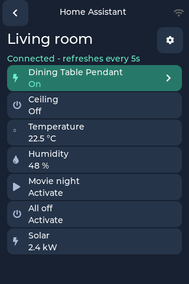

Compact rows show more of each device name and fit up to seven entities per page.
Paging controls disappear when there is only one page. Tap a light's arrow to
adjust brightness, warmth and, when supported, its colour. The device name and
on/off state share the toggle button, leaving room for the controls.

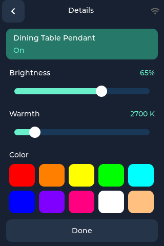

Adding devices is faster in large installations: the picker starts with Lights,
searches only when requested, and loads 25 results at a time. Unavailable entities
are hidden by default; turn off that filter to find them. You can also add a
device by its entity ID. Controls show pending actions while Home Assistant
confirms the change.

### Set up Home Assistant with your phone or browser

You need an existing Home Assistant installation and a phone or computer on the
same trusted Wi-Fi network as your Color Kit Grande. The screenshots below use
demo devices and credentials.

**1. Open the setup QR code on the device.** Open **Home Assistant**, then tap
**Configure** (or the gear icon if a dashboard is already configured). Keep this
screen open while you work in the browser. Setup closes after ten minutes of
inactivity.

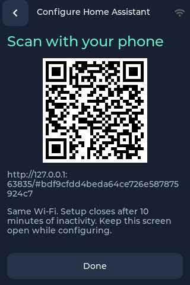

**2. Scan your device's QR code.** Use your phone's camera and open the link. It
opens the setup page hosted by the device and pairs your browser automatically.
Scan the code on your own device, not the example above. On a computer, you can
instead enter the complete address shown on the device, including `#` and the
pairing code. This setup address is different from your Home Assistant address.

**3. Connect to Home Assistant.** On **1 · Connect**, enter the server address,
for example `http://homeassistant.local:8123`. In Home Assistant, open your
profile, go to **Security**, and create a long-lived access token for Gadget OS.
Copy the token when it appears; Home Assistant cannot show it again later.
[Home Assistant token instructions](https://contributors.home-assistant.io/core/internals/auth-api/#long-lived-access-tokens).
Paste it into **Long-lived access token** in the setup page, then choose
**Save connection & continue**. The token stays masked in the browser and
is stored on the device; layout exports do not contain it.

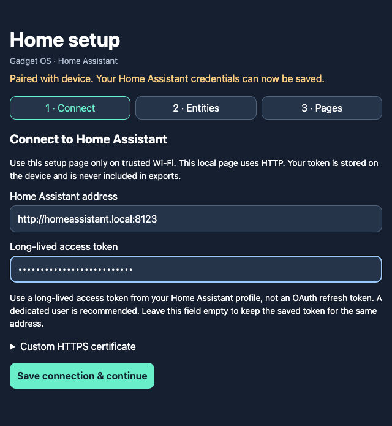

**4. Choose your entities.** Select a target page and entity type, then tap
**Search**. Lights are selected initially, and **Hide unavailable entities** is on.
Tap **Add** beside each device you want; **Added** confirms your selection. Results
load in batches of 25. If your Home Assistant account cannot use discovery, open
**Add by entity ID** and enter an ID such as `light.living_room` instead. Automatic
discovery requires an administrator token; manual entry does not grant extra
permissions to the account.

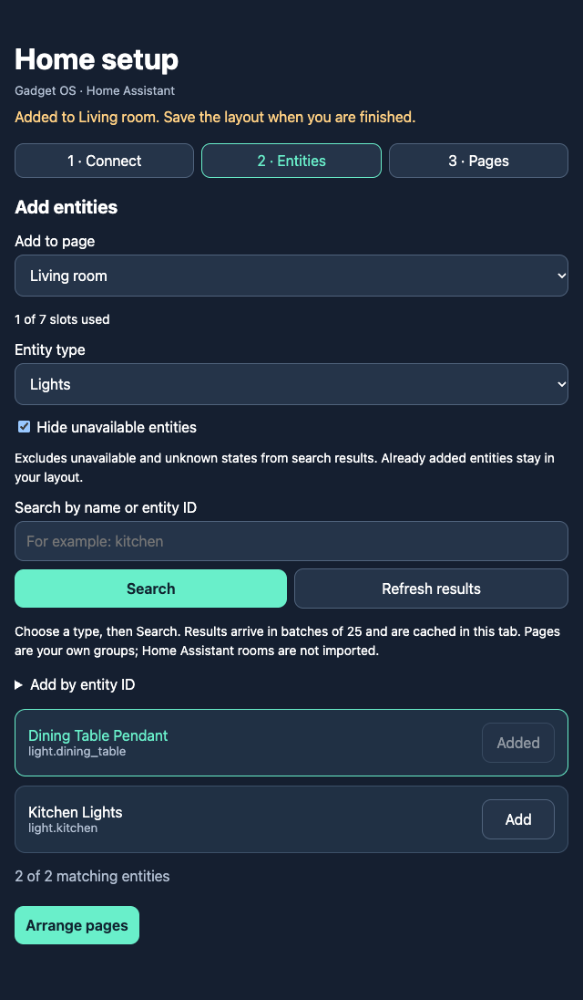

**5. Arrange and save your dashboard.** Open **Arrange pages**. Name your pages,
drag tiles into order or use their arrow buttons, and choose **Edit** to change a
tile's name or icon. You can create up to four pages with seven entities each.
These are your own groups; Home Assistant rooms are not imported automatically.
Tap **Save to device** and wait for the saved confirmation. Finally, tap **Done**
on the device to leave setup and use your dashboard.

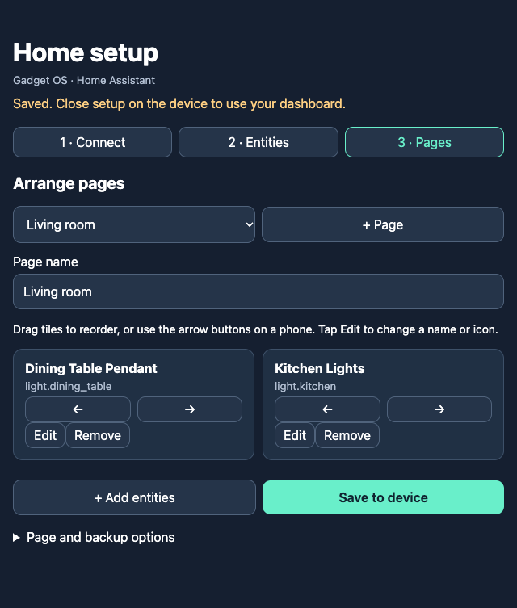

If pairing expires, reopen Configure and scan the new code. Your browser's edits
are kept, but you must pair again before saving. Only use the setup page on a
trusted local network; it uses HTTP and should not be exposed to the internet.

## ISS

The new **ISS** app helps you plan when to look for the International Space Station.
It uses the active Weather location, or your Planes location if none is set.

See the countdown, rise and set directions, maximum elevation and predicted
visible duration. During a pass, the screen shows its progress and remaining
visible time. **Passes** lists upcoming opportunities; switch from **Visible** to
**All** to include passes that are not expected to be visible. Predictions are
saved for later use, and old or offline data is labelled. Clear skies and an
unobstructed view are still needed.

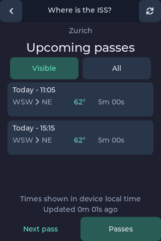

## Transit

The new **Transit** app brings your local departure board to the main screen.
Search for stops, save up to eight favourites, and swipe between their boards.
See destinations, platforms, departure countdowns and delays or cancellations
where the operator supplies them. Tap a departure to see its route stops.

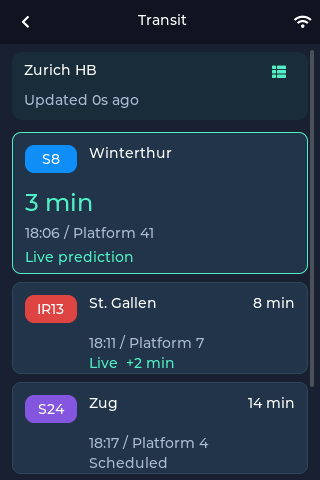

Times follow your device's timezone. Departures refresh while the app is open;
last-loaded results remain available if a refresh fails. Coverage and live data
depend on the transport operator and Transitous.

## Stocks

The new **Stocks** app supports a watchlist of up to ten symbols, including
international listings. Open a stock for its price, daily change and **5D**, **1M**
or **1Y** chart. Swipe between stocks, or edit the watchlist to add, remove and
reorder symbols.

| Watchlist | AAPL price and history |
| --- | --- |
| 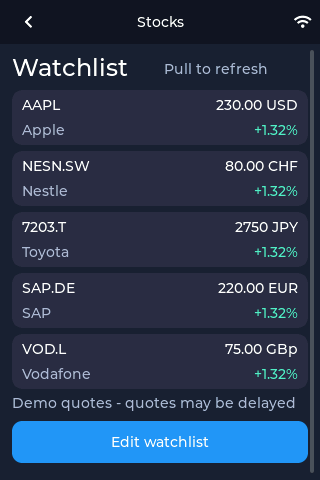 | 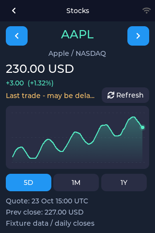 |

Prices retain their quoted currency. Quotes may be delayed; cached or unavailable
data is identified on screen.

## Planes

The radar has more room for aircraft, with selectable range and metric or imperial
units. Select a plane to follow its trail and open its aircraft and route details.
Aircraft and trail segments use altitude colours; older trail segments fade,
helping you see climbs and descents.

| Radar with the cached ZRH airport marker | Details of a selected flight |
| --- | --- |
| 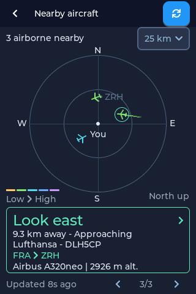 | 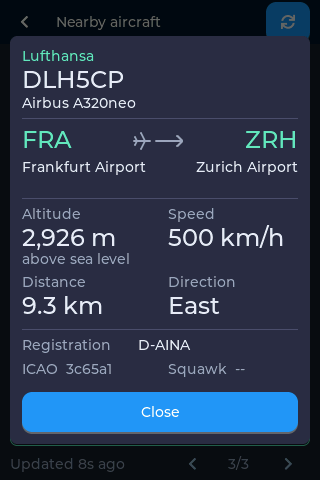 |

Nearby airports appear as faint dots and short codes as they are learned from
flight-route responses. The airport cache survives restarts, so the map can retain
those markers when you return. Changing location or range replaces the cache for
the previous view. No separate airport database needs to be downloaded.

## Weather

Swipe horizontally to move between saved locations, or use the location arrows.
The wind arrow now shows the direction of airflow, and condition readings line
up more clearly. Imperial pressure can be shown in inches of mercury.

Tap **Hourly** below the current conditions to open the hourly forecast.

| Current conditions | Hourly forecast |
| --- | --- |
| 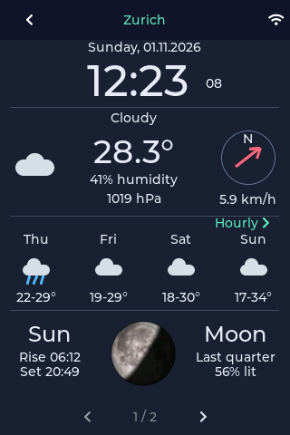 | 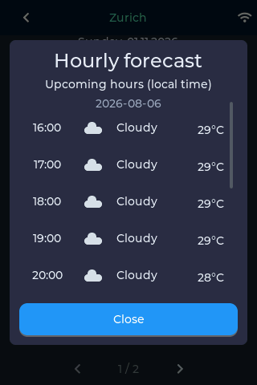 |

## Settings and keyboard

German is now available under **Settings → Language**, including translated app
screens, settings and update dialogs.

Ordinary preferences save immediately and briefly show **Saved**. Forms use
**Connect** or **Save**; leaving an edited form offers **Save**, **Discard** or
**Keep editing**. Display brightness saves when you release the slider.

The on-screen keyboard has larger keys and a pressed-key preview. Wi-Fi scanning
reduces typing, and coordinate fields use a numeric keypad.

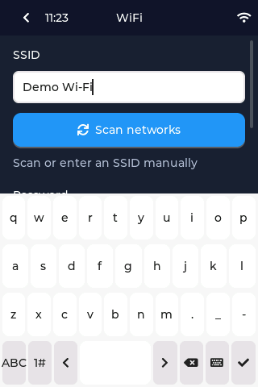

## Launcher and software updates

Home Assistant has moved out of Labs, and app labels now support two lines.
Transit, Stocks and ISS are also available directly from the main launcher.

Before installing an update, tap **What's new** and scan the QR code to read the
illustrated notes on your phone. The confirmation after installation also shows
the QR code. Both codes open this illustrated changes page directly, with a link
to the German translation.

These new dialogs appear once firmware containing this feature is installed;
older firmware still uses its existing pre-update dialog. Background update checks
run roughly once a day after a successful check, with retries when a check fails.
