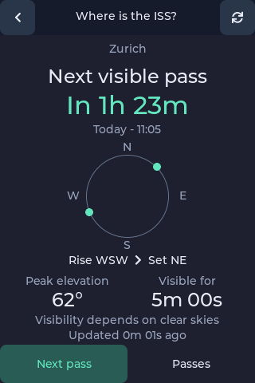
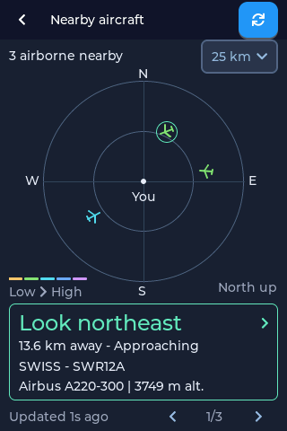
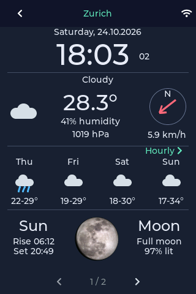

# Gadget OS changes since v0.1.3

New apps and everyday improvements for **Color Kit Grande**. Control your home,
watch for the ISS, check departures and follow your stocks—all from the launcher.

[Deutsch](since-v0.1.3.de.md)

## Home Assistant

**Home Assistant** is now on the main launcher page. Connect to your own Home
Assistant installation and arrange lights, switches, sensors, scenes and scripts
into up to four custom pages. Open **Configure** and scan the setup QR code to
choose and arrange your devices in a browser.

Compact rows show more of each device name and fit up to seven entities per page.
Paging controls disappear when there is only one page. Tap a light's arrow to
adjust brightness, warmth and, when supported, its colour. The device name and
on/off state share the toggle button, leaving room for the controls.

Adding devices is faster in large installations: the picker starts with Lights,
searches only when requested, and loads 25 results at a time. Unavailable entities
are hidden by default; turn off that filter to find them. You can also add a
device by its entity ID. Controls show pending actions while Home Assistant
confirms the change.

## ISS

The new **ISS** app helps you plan when to look for the International Space Station.
It uses the active Weather location, or your Planes location if none is set.

See the countdown, rise and set directions, maximum elevation and predicted
visible duration. During a pass, the screen shows its progress and remaining
visible time. **Passes** lists upcoming opportunities; switch from **Visible** to
**All** to include passes that are not expected to be visible. Predictions are
saved for later use, and old or offline data is labelled. Clear skies and an
unobstructed view are still needed.

## Transit

The new **Transit** app brings your local departure board to the main screen.
Search for stops, save up to eight favourites, and swipe between their boards.
See destinations, platforms, departure countdowns and delays or cancellations
where the operator supplies them. Tap a departure to see its route stops.

Times follow your device's timezone. Departures refresh while the app is open;
last-loaded results remain available if a refresh fails. Coverage and live data
depend on the transport operator and Transitous.

## Stocks

The new **Stocks** app supports a watchlist of up to ten symbols, including
international listings. Open a stock for its price, daily change and **5D**, **1M**
or **1Y** chart. Swipe between stocks, or edit the watchlist to add, remove and
reorder symbols.

Prices retain their quoted currency. Quotes may be delayed; cached or unavailable
data is identified on screen.

## Planes

The radar has more room for aircraft, with selectable range and metric or imperial
units. Select a plane to follow its trail and open its aircraft and route details.
Aircraft and trail segments use altitude colours; older trail segments fade,
helping you see climbs and descents.

Nearby airports appear as faint dots and short codes as they are learned from
flight-route responses. The airport cache survives restarts, so the map can retain
those markers when you return. Changing location or range replaces the cache for
the previous view. No separate airport database needs to be downloaded.

## Weather

Swipe horizontally to move between saved locations, or use the location arrows.
The wind arrow now shows the direction of airflow, and condition readings line
up more clearly. Imperial pressure can be shown in inches of mercury.

## Settings and keyboard

German is now available under **Settings → Language**, including translated app
screens, settings and update dialogs.

Ordinary preferences save immediately and briefly show **Saved**. Forms use
**Connect** or **Save**; leaving an edited form offers **Save**, **Discard** or
**Keep editing**. Display brightness saves when you release the slider.

The on-screen keyboard has larger keys and a pressed-key preview. Wi-Fi scanning
reduces typing, and coordinate fields use a numeric keypad.

## Launcher and software updates

Home Assistant has moved out of Labs, and app labels now support two lines.
Transit, Stocks and ISS are also available directly from the main launcher.

Before installing an update, tap **What's new** and scan the QR code to read the
illustrated notes on your phone. The confirmation after installation also shows
the QR code. Each code points to the matching release, so you read the changes
for that version.

These new dialogs appear once firmware containing this feature is installed;
older firmware still uses its existing pre-update dialog. Background update checks
run roughly once a day after a successful check, with retries when a check fails.
