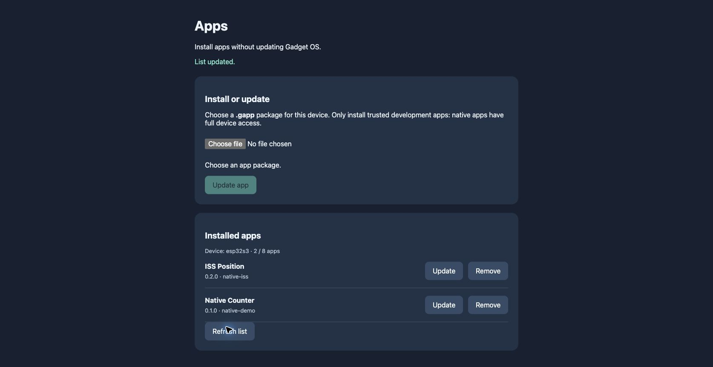

# Browser-installed native apps — 2026-11-04

Implemented on `experiment/native-app-loader`, following the API 1.1 HTTP app
experiment. This is an opt-in developer feature; normal firmware profiles do
not include the loader or installer.

## User workflow

Open **Labs → Apps**, scan its QR code using a browser on the same local network,
and select a `.gapp` package for the device. The browser previews its name,
version and chip. Installation, replacement and removal update the launcher
without rebuilding or rebooting the host firmware. Installed apps have their
own packaged icons under Labs and can close back to the launcher.

The browser lists installed versions and prevents changing a running app. The
server checks this independently. Packages remain in LittleFS across restart.
The examples left on both test devices are Native Counter 0.1.0 and ISS Position
0.2.0; the latter version was used to demonstrate an in-place package update.

## Implementation

- One `.gapp` contains a bounded manifest, a 40×40 RGB565 icon and the target ELF.
  SHA-256 covers the length header and complete payload.
- Generic IDs replace the earlier fixed counter/ISS launch registrations. An
  independently named test package was installed and executed on both devices.
- Uploads stream to `/apps/.incoming.gapp`. Validation and file close precede
  `LittleFS.rename` over `/apps/installed/<id>.gapp`; there is no delete-first gap.
- The temporary pairing key expires after ten idle minutes. It is sent in a URL
  fragment for initial pairing, then an HTTP header; Host/Origin checks and no
  CORS restrict browser access. The HTTP server runs only after opening Apps.
- Socket reads/writes are bounded per UI poll, with nonblocking sends, request
  timeouts and explicit disconnected-peer cleanup. App/OTA mutation checks and
  deferred launcher rebuilding stay on the UI thread.
- Dynamic icon buffers belong to their launcher images and are released, with
  their LVGL image-cache entries, when the launcher is destroyed.
- The catalog supports eight packages. Maximum package size is 70,836 bytes:
  52-byte header, 2048-byte manifest, 3200-byte icon and 65,536-byte ELF.

## Verification

All five profiles build: both experimental targets, both normal targets and the
native simulator. The [artifact audit](results/install-build-audit.json) confirms
that normal device ELFs contain no native loader symbols. Desktop tests ran on
macOS with ASan/UBSan: existing parser/gate/HTTP regressions, 40,000 ELF mutations,
100 simulated HTTP lifecycle cycles, and the new package validator's metadata,
compatibility, every truncation and every single-byte corruption checks passed.

Both connected devices received firmware-only flashes. No device backups,
filesystem-image writes or restoration were performed.

| Hardware/browser check | Pro | Grande |
| --- | --- | --- |
| Browser installation of ISS Position | Pass | Pass |
| HTTP install, replace and remove a generic-ID package | Pass | Pass |
| Invalid key, foreign Origin and foreign Host rejected | Pass | Pass |
| Wrong chip/API/path, corrupt and truncated package rejected | Pass | Pass |
| Interrupted body/header keeps prior version; next request recovers | Pass | Pass |
| Installed executable runs; running update/remove rejected | Pass | Pass |
| Eight-app cap; updating an existing app while full | Pass | Pass |
| Installed versions persist across firmware reflash/restart | Pass | Pass |
| Final firmware: 100 open/reset/close cycles | Pass | Pass |

Additional browser checks: Pro updated ISS 0.1.0 → 0.2.0 in place; Grande removed
and reinstalled ISS. Uploading a Grande package to Pro showed the compatibility
error and retained the installed version. Running-app controls remained disabled
after that failure. Chrome's automation file-access permission was enabled for
the test; end users do not need the ChatGPT extension to use the installer.

The first firmware also completed 100 cycles per device while other app packages
were installed/updated/removed. Final memory measurements use a separate 100-cycle
run with an unchanged catalog, after the last firmware changes. Both pass the
existing 1024-byte decline tolerance after warm-up. Pro internal free-memory
median fell by 68 bytes; Grande's increased. Largest executable/internal blocks
were unchanged. See the captured [Pro](results/install-pro-cycles.log.analysis.txt)
and [Grande](results/install-grande-cycles.log.analysis.txt) analyses and adjacent
filtered logs. These measurements detect continuing decline, not every possible
memory defect. API acceptance logs are also in `results/install-*-api.log`. The installed ISS
package fetched live HTTPS data on launch and Refresh on both devices (two
HTTP 200 responses each), then closed using its LVGL button callback; filtered
results are in `results/install-*-http.log`.

Manual checks also passed: Grande showed Apps, ISS Position and Native Counter
in Labs; launching ISS from its icon, Refresh, Close and Calculator 1 + 2 = 3
worked. The Pro's new icons and labels were visually confirmed. Its earlier
intermittent physical touch issue was deliberately not reopened.

## Limits

Packages are unsigned native code with firmware privileges. SHA-256 checks
integrity, not publisher identity; the loader is not a sandbox. Use trusted
packages and a trusted local network (the pairing server uses plain HTTP).
There is no runtime rollback for a structurally valid app that crashes or fails
initialization. Only the SDK's supported ELF/API subset is accepted.

Atomic replacement relies on [LittleFS's rename guarantee](https://github.com/littlefs-project/littlefs).
Interrupted connections were tested; physical power-cut fault injection was not.
The restart test preserved the same partition layout and compatible host API;
it is not a test of arbitrary future OTA/partition migrations.

Earlier loose app directories are preserved but no longer discovered. Reinstall
those samples as `.gapp` packages. The Pro's previously reported intermittent
physical touch behaviour remains outside this installer change.
